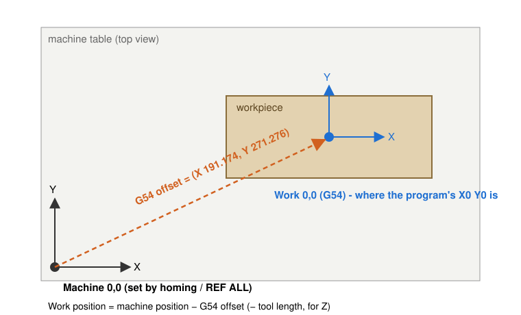
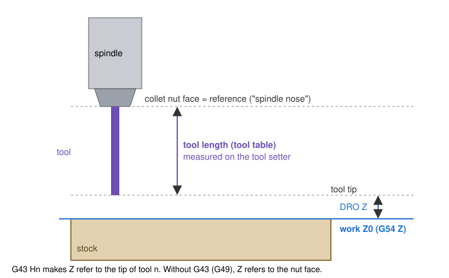

# 1. The two ideas everything rests on

Almost every confusing moment in Probe Basic comes back to two questions:

1. **Where is the part?** That is answered by the *work offset*.
2. **Where is the tip of the cutter?** That is answered by the *tool length offset*.

Once both are right, a program that says "go to X0 Y0 Z−0.3" puts the tip of whatever cutter is loaded exactly 0.3 mm below the top of your part, at the point the program calls zero.

## Machine coordinates

When you press **REF ALL** (home), each axis drives to its switch and LinuxCNC sets **machine coordinates**. They are fixed to the frame of the machine and never change until the next homing. On most routers machine Z0 is the *top* of Z travel, so every Z position below it is negative.

Machine coordinates are what the soft limits use. They are also what tool-change positions, the tool setter position and other "fixed places on the table" are stored in.

## Work coordinates and the work offset (G54)

Your CAM program is not written in machine coordinates. It is written relative to the part: typically X0 Y0 at a corner or the center, and Z0 on the top surface. The **work offset** connects the two. It is simply the position of the part's zero point, expressed in machine coordinates.

LinuxCNC has nine work offsets: **G54, G55, G56, G57, G58, G59, G59.1, G59.2 and G59.3**. Each is a separate stored zero, so you can keep several fixtures or vises set up at once and pick one per job. Most people only ever use G54, which is also the default selected at startup.

You can set a work offset three ways:

- **With the probe** (the best way). A probing routine finds the part's edges or center and writes the result into the active offset. See chapter 5.
- **By touching off**: jog to a known point and press **ZERO X / ZERO Y / ZERO Z** (or use the touch plate for Z).
- **By typing**: `G10 L2 P1 X… Y… Z…` writes G54 directly in machine coordinates. `G10 L20 P1 X0` means "make *where I am now* X0 in G54".

Work offsets are saved in the parameter file (the `.var` file), so they survive a restart. After a restart you only need to home again.

> **On the 6040.** The isogrid test job used G54 = X 191.174, Y 271.276, Z −102.427. That is the center and top of a piece of plywood, found with the 3D probe's RECT BOSS routine.

## Tool length offsets (G43)

LinuxCNC needs to know how far each cutter's tip sits below a fixed reference point on the spindle. On most hobby machines that reference is the **face of the collet nut** (sometimes called the spindle nose). The distance from that face down to the tip is the tool's **length**, stored in the **tool table**.

**G43 Hn** tells LinuxCNC "the tool in the spindle is tool *n*; apply its length". From then on, Z positions and the Z readout refer to the tip of that tool. **G49** cancels it, and Z refers to the nut face again.

This is why a program can change from a 6 mm end mill to a 1/8" end mill and keep cutting at the right depth. Each tool's length is different, but G43 corrects for it.

Tool lengths are measured with a **tool setter**, a switch fixed to the table that the cutter is lowered onto. See chapter 6.

## Why both matter: the shared reference

The tool setter, the touch plate and the 3D probe all agree because they all use the same reference: the nut face.

- The setter measures each tool's length from the nut face.
- The probe is just another "tool" in the table (often T99), with its own measured length.
- When the probe touches the top of the part, LinuxCNC knows where the *ball tip* is (because G43 is active for T99). It stores the part's top as G54 Z0.
- When the program later loads T1 and applies G43 H1, "Z0" puts T1's tip on that same surface.

> **The most common mistake.** Probing with the probe in the spindle but **without G43 active** for it. LinuxCNC then thinks the nut face touched the part, and Z0 ends up one probe-length too high. On the 6040 that was 46.87 mm, so the program cut air. The fix is to always load the probe with **M6 G43** (chapter 5).

## Summary

| Question | Answer | Set by | Stored in |
|---|---|---|---|
| Where is the machine? | Machine coordinates | REF ALL (homing) | Re-found at every homing |
| Where is the part? | Work offset (G54…) | Probing, ZERO buttons, G10 L2/L20 | Parameter file (`.var`) |
| Where is the cutter tip? | Tool length (G43 Hn) | Tool setter, TOUCH OFF | Tool table |
