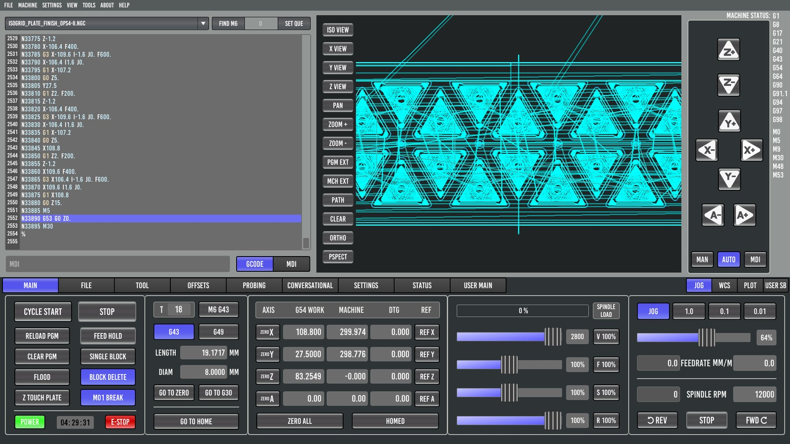
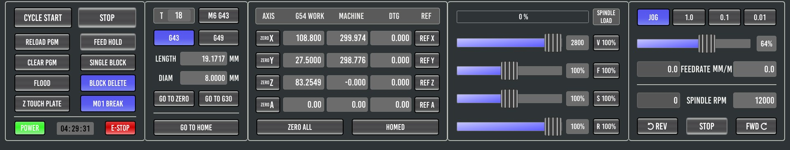
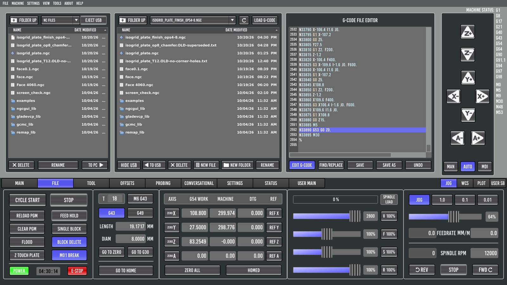
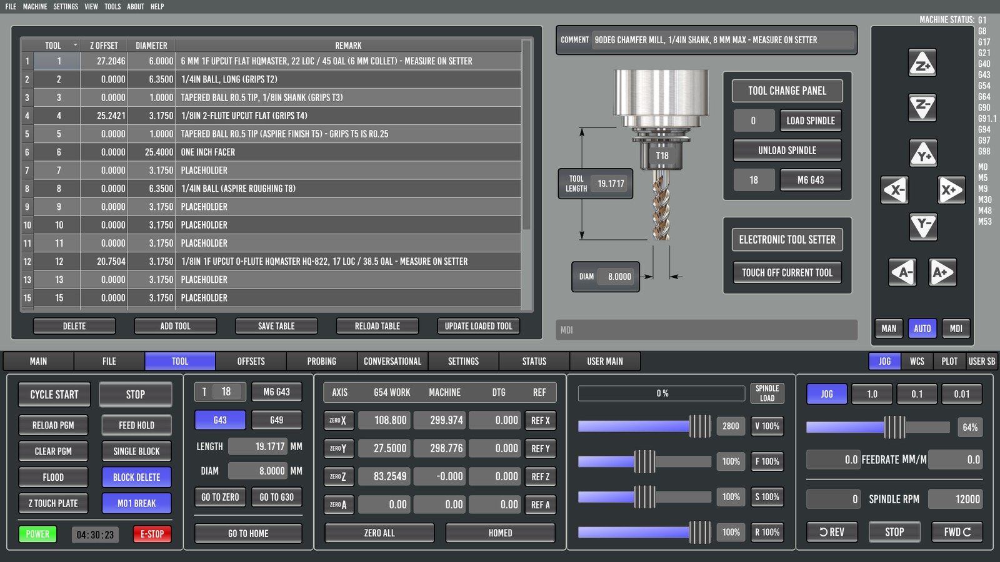
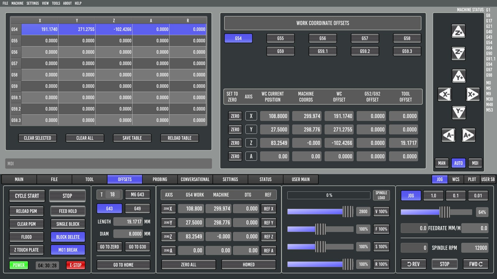
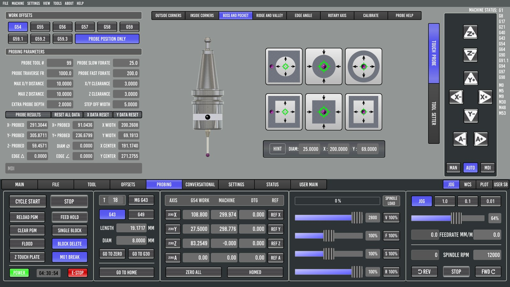
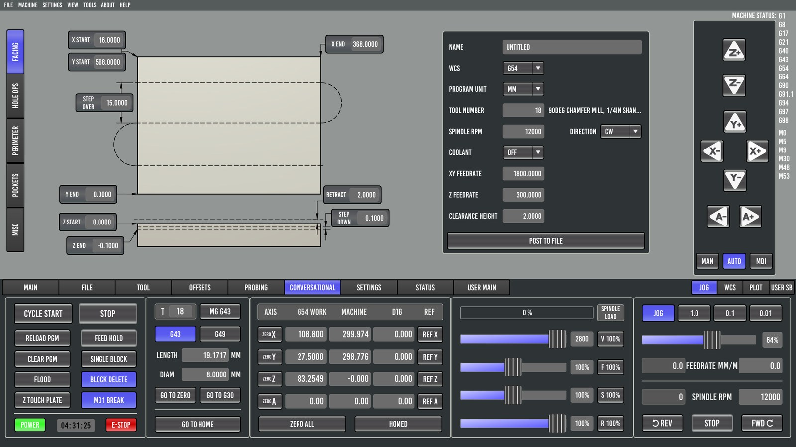
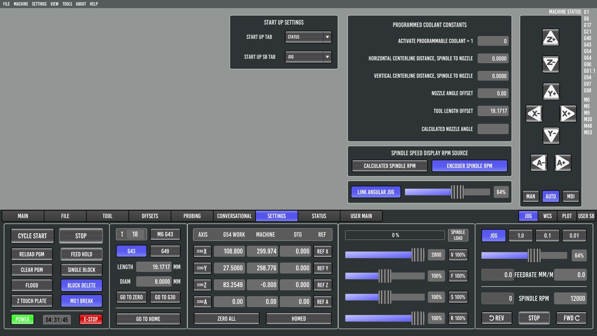
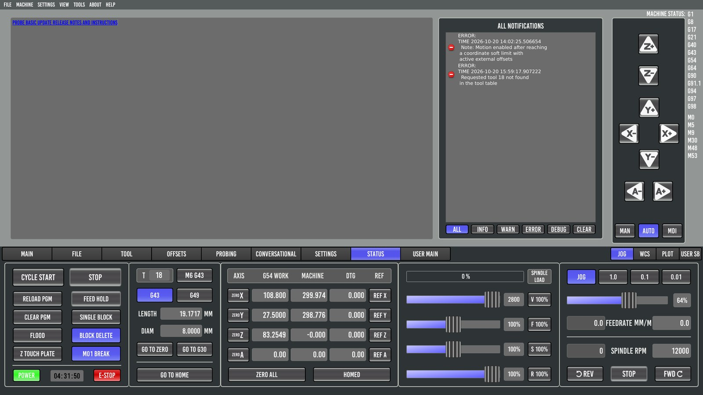

# 2. A tour of the screen

Probe Basic's window has three parts:

- **The upper area** changes with the tab you pick in the tab bar: MAIN, FILE, TOOL, OFFSETS, PROBING, CONVERSATIONAL, SETTINGS, STATUS, plus USER MAIN (and ATC, when enabled).
- **The right column** is the same on every tab: jog arrows for each axis, the **MAN / AUTO / MDI** mode buttons, and **MACHINE STATUS**. MACHINE STATUS lists the active G and M codes (G54, G43, G90 and so on), which is handy for checking that G43 is really on.
- **The control strip** along the bottom never changes. It holds everything you need while a program runs.

## The bottom control strip

Learn this strip first. From left to right:

### Program control

| Button | What it does |
|---|---|
| **CYCLE START** | Runs the loaded program, or resumes after FEED HOLD or an `M1` pause. It is greyed out until the machine is on, homed and idle, with a program loaded. |
| **STOP** | Aborts the program. You lose your place. |
| **RELOAD PGM** | Re-reads the program file from disk. Use it after editing or re-posting the file. |
| **FEED HOLD** | Freezes motion and keeps your place. **The spindle keeps running.** CYCLE START continues; while paused, a blinking RESUME shows. |
| **CLEAR PGM** | Unloads the program. |
| **SINGLE BLOCK** | When lit, each CYCLE START runs one line. |
| **FLOOD** | Flood coolant on/off. |
| **BLOCK DELETE** | When lit, lines starting with `/` are skipped. |
| **Z TOUCH PLATE** | *On the 6040:* a custom user button that runs the touch-plate Z zero (`touch_plate.ngc`). Stock Probe Basic has MIST here. |
| **M01 BREAK** | When lit, the program pauses at every `M1` (optional stop). Fusion 360 puts one before tool changes. |
| **POWER** | Machine on/off, green when on. Toggling it also makes Probe Basic re-check its state. |
| Timer | Running time of the current program. |
| **E-STOP** | Software E-stop: red = OK, grey = E-stopped. Your physical E-stop button always overrides it. |

### Tool panel

| Item | What it does |
|---|---|
| **T** box + **M6 G43** | Type a tool number and press it: tool change to that tool, then apply its length. Use it to load the probe (T99). |
| **G43 / G49** | Tool length offset on/off. The lit one is active. |
| **LENGTH / DIAM** | Length and diameter of the tool in the spindle, from the tool table. |
| **GO TO ZERO** | Lifts Z, then moves to work X0 Y0. |
| **GO TO G30** | Moves to the stored G30 position (the tool-setter position). |
| **GO TO HOME** | Moves to machine home. |

### Position readout (DRO)

| Column | Meaning |
|---|---|
| **ZERO X / Y / Z / A** | Makes the current position zero in the active work offset. **It moves your work zero.** |
| **G54 WORK** | Position relative to the part. With G43 on, that is the tool tip. The header shows the active offset. |
| **MACHINE** | Absolute machine position. |
| **DTG** | Distance to go in the current move. |
| **REF X / Y / Z / A** | Homes that axis. |
| **ZERO ALL** | Zeroes all axes at the current spot. |
| **REF ALL / HOMED** | Homes everything, then reads HOMED. |

### Overrides

The top bar is **SPINDLE LOAD**. Below it are four sliders, each with a button that snaps it back to 100 %:

| Slider | Effect |
|---|---|
| **V** | Maximum velocity for all moves. The number shows the limit in mm/min (2800 on the reference machine). |
| **F** | Feed override: scales every cutting feed. Turn it down for the first plunge of a new program. |
| **S** | Spindle speed override. |
| **R** | Rapid override. |

### Jog and spindle (right)

- **JOG** turns keyboard and on-screen jogging on. **1.0 / 0.1 / 0.01** pick a step size; with none lit, jogging is continuous.
- The **slider** sets the jog speed, as a percentage of maximum.
- **FEEDRATE MM/M**: actual feed on the left, programmed F on the right.
- **SPINDLE RPM**: actual rpm on the left, commanded S on the right. On the reference machine, actual rpm is read from the VFD over Modbus.
- **REV / STOP / FWD** run the spindle by hand.

At the right end of the tab bar, **JOG / WCS / PLOT / USER SB** switch this small panel between jog controls, work-offset buttons, preview options and user buttons.

## The tabs

### MAIN

The program listing (left), the 3D toolpath preview (center) and the right column. Along the top of the listing:

- **FIND M6** finds tool changes in the program.
- The line-number box and **SET QUE** are for **run from line**.

**GCODE / MDI** switch the left panel between the program and the MDI keypad, history and queue. Preview buttons: ISO / X / Y / Z VIEW, PAN, ZOOM ±, PGM EXT (fit the program), MCH EXT (fit the machine), PATH and CLEAR (the live tool trail), ORTHO / PSPECT.

> **Run from line** doesn't replay what came before that line: position, feed, work offset, tool, tool length, spindle. Start only at the beginning of an operation, where the program sets all of those itself.

### FILE

Two file browsers, for USB on the left and the PC's `nc_files` on the right, with **LOAD G-CODE**, TO PC / TO USB, NEW FILE / NEW FOLDER / RENAME / DELETE. The right side is a **G-code editor**: EDIT G-CODE, FIND/REPLACE, SAVE, SAVE AS, UNDO.

### TOOL

The tool table on the left; chapter 7 covers it. On the right:

- the selected tool's picture with its length, diameter and comment,
- the **TOOL CHANGE PANEL** (a tool number + **M6 G43**; LOAD/UNLOAD SPINDLE are for ATCs),
- **ELECTRONIC TOOL SETTER → TOUCH OFF CURRENT TOOL** (chapter 6).

### OFFSETS

All nine work offsets, plus a breakdown of the current position. See chapter 4.

### PROBING

The probing suite, with two vertical sub-tabs on the right edge: **TOUCH PROBE** and **TOOL SETTER**.

- **Left column:** work-offset selection, **PROBE POSITION ONLY**, the probing parameters and **PROBE RESULTS**.
- **Pages across the top:** OUTSIDE CORNERS, INSIDE CORNERS, BOSS AND POCKET, RIDGE AND VALLEY, EDGE ANGLE, ROTARY AXIS, CALIBRATE, PROBE HELP.

See chapters 5 and 6.

### CONVERSATIONAL

Generates simple programs from a form. The vertical sub-tabs on the left are FACING, HOLE OPS, PERIMETER, POCKETS and MISC. See chapter 9.

### SETTINGS

Startup tab, programmable coolant constants, the spindle-rpm display source (calculated or encoder), and the angular-jog link.

### STATUS

**ALL NOTIFICATIONS**: every error and message with its time, with filters for INFO / WARN / ERROR / DEBUG. **Look here first when something "did nothing".** On the reference machine it showed the "Requested tool 18 not found" error with its exact time, which led to the cause.

### USER MAIN

An empty tab for your own panels (`user_tabs/` in the config).
