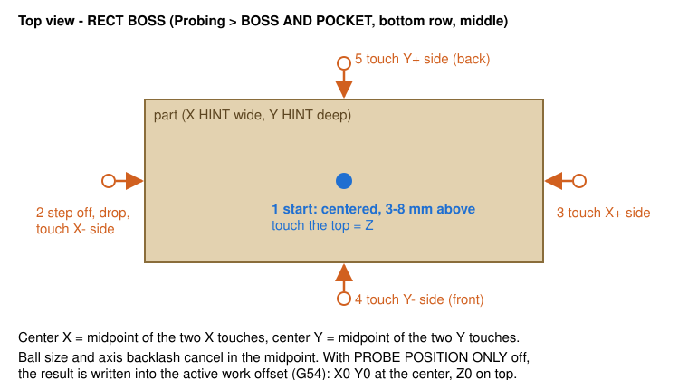

# 3. Your first job, start to finish

This is the complete sequence for a CAM program with several tools, a part held on the table, a 3D probe and a tool setter. It is the routine used for every job on the reference machine.

## 1. Power up and home

1. Switch on the control box (stepper drivers, VFD, Mesa card), then start LinuxCNC.
2. Release the E-stop and press **POWER**.
3. Press **REF ALL**. Each axis homes in turn; Z goes first on most routers so the spindle lifts clear. The button then reads **HOMED**.

You must home after every LinuxCNC start. Work offsets and tool lengths are kept, but LinuxCNC can't know where the axes are until they find their switches.

## 2. Load the program

**FILE** tab → select the file → **LOAD G-CODE**. Then check the preview on the MAIN tab:

- The whole toolpath should draw. If you only see a few lines, the preview stopped at an error; check STATUS. (A subroutine that probes during the program can cause this. See chapter 11.)
- **PGM EXT** zooms to the program. Check it is roughly where you expect relative to the part.

## 3. Load the probe

Put the 3D probe in the spindle. In the **T** box at the bottom type the probe's tool number (often **99**), then press **M6 G43**.

- **M6** tells LinuxCNC that tool is now in the spindle. On a manual-change machine it lifts Z and asks you to insert it; just confirm.
- **G43** applies the probe's measured length, so Z now refers to the ball tip.

Check: the T box shows 99, the **G43** button is lit, and **LENGTH** shows the probe's length. Tap the stylus; the probe LED on screen should light. A normally-open probe that is unplugged never triggers, so always test it.

## 4. Find the part with the probe

Go to **PROBING → TOUCH PROBE**.

1. Turn **PROBE POSITION ONLY** **off**. While it is on, routines only measure and report. While it is off, they write the result into the active work offset, which is what you want now.
2. Pick the routine that matches the part. For a rectangular block or board whose center is your zero: **BOSS AND POCKET → RECT BOSS** (bottom row, middle).
3. Enter the part's approximate size in **X HINT** and **Y HINT**. The routine steps out by half the hint plus the step-off width before it drops down beside the part.
4. Jog the probe over the middle of the part, within a few millimetres of center, with the ball 3–8 mm above the top. That must be within MAX Z DISTANCE.
5. Press the routine button. The probe touches the top (Z0), then both X sides and both Y sides, and returns over the center.
6. Read **PROBE RESULTS**: X WIDTH and Y WIDTH should match the part. The DRO should now read about X0 Y0, and Z = the Z CLEARANCE.
7. Turn **PROBE POSITION ONLY** back **on**, so a later measurement can't move your zero by accident.

For a corner zero instead, use **OUTSIDE CORNERS** and pick the corner. Chapter 5 covers every routine.

## 5. Check Z before cutting (30 seconds, worth it)

With the probe still loaded and G43 on, the DRO Z shows the ball's height above the part. Hold a ruler to the gap. If the DRO says 55 and the gap is 55 mm, the zero is right. If the gap is about one probe-length different, G43 wasn't active during probing: redo step 3, then step 4.

## 6. Run

1. Take the probe out.
2. Turn the **F** (feed override) slider down to 25–50 % for the start.
3. Press **CYCLE START**.
4. At the first `T1 M6` the machine lifts Z and asks for tool 1. Insert it and confirm.
   - **With the M6 remap** (chapter 6): it drives to the tool setter, measures the tool and continues. Nothing else to do.
   - **Without the remap**: the program uses whatever length is in the tool table, so you must have measured the tool beforehand with TOUCH OFF CURRENT TOOL.
5. Watch the first plunge. The tip should land where the program says, for example just below the top surface for a facing pass. If anything looks wrong, press **FEED HOLD**.
6. Once it looks right, bring the feed override back to 100 %.

## 7. Tool changes and pauses

- **Every `M6`**: lift, prompt, insert, confirm, measure (with the remap), continue.
- **`M1`** (optional stop): the program pauses only if **M01 BREAK** is lit. Press CYCLE START to continue.
- **Pausing**: **FEED HOLD**, then **CYCLE START** to resume. The spindle keeps turning during a hold, so keep hands and the vacuum nozzle away from the cutter. In metal, keep holds short: a spinning tool that is not moving rubs and heats up.

## 8. When it finishes

The program ends with `M30`: spindle off, offsets kept. The work offset stays valid as long as the part doesn't move, so you can re-run, or run a second program on the same part, without probing again.

> **On the 6040.** The first job on this machine was an aluminum isogrid plate, test-cut first in plywood. It used three tools: a 6 mm single-flute for facing and roughing, a 1/8" single-flute O-flute for corners, walls, holes and the profile, and a 90° chamfer mill. G54 came from RECT BOSS on the stock, and every tool was measured on the setter at its M6.
