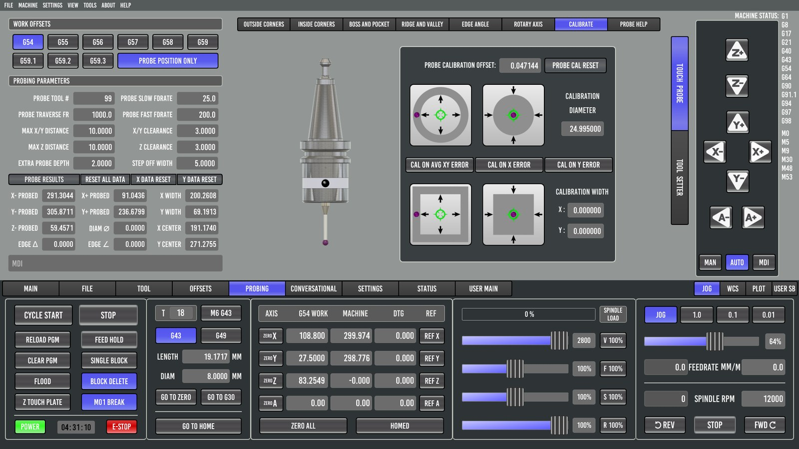
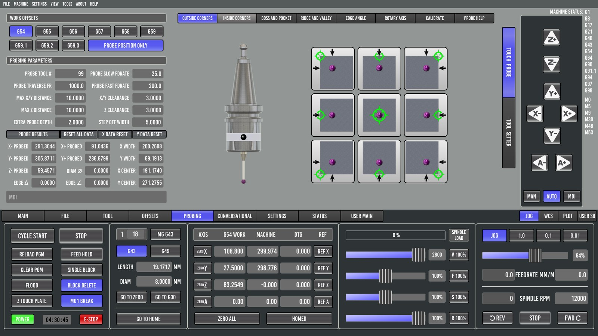
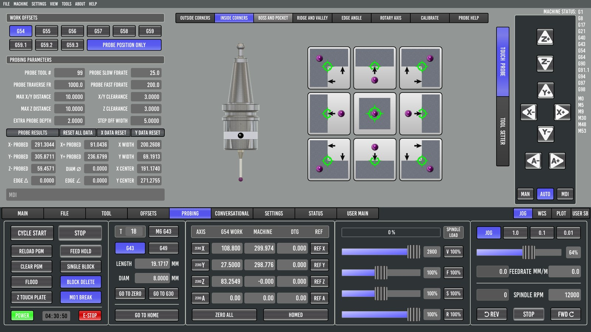
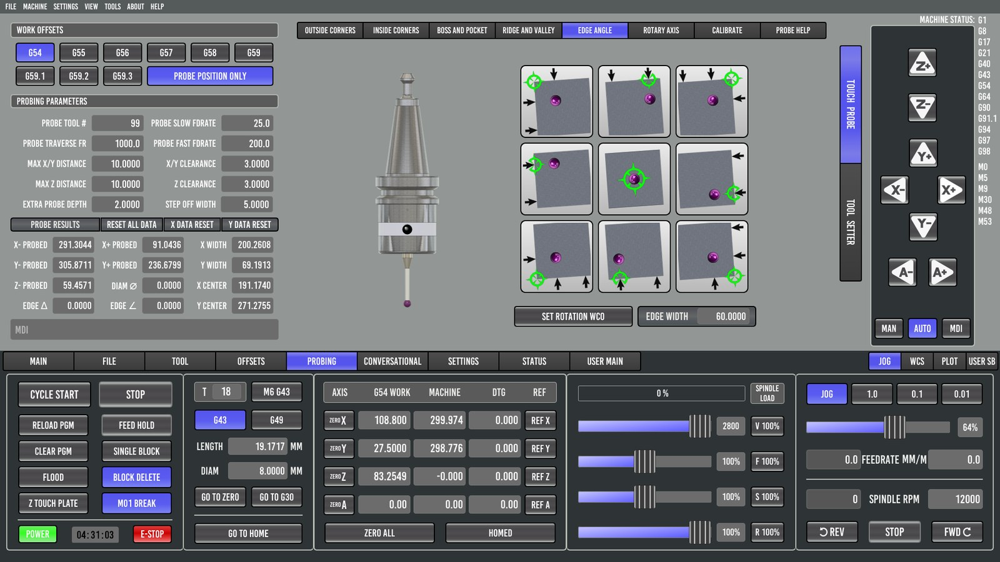
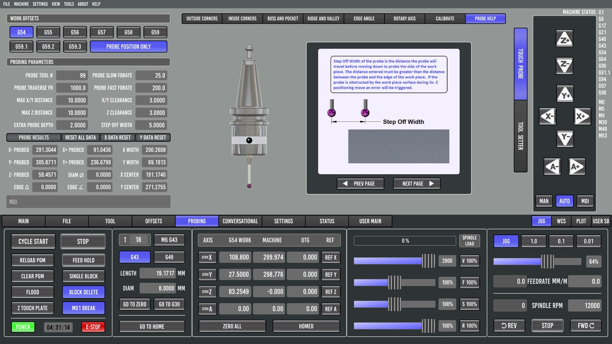

# 5. Probing

A 3D touch probe turns "find the edge of the part" into a button press, and is far more accurate than an edge finder or eyeballing. Probe Basic's probing suite is its biggest strength.

## Setting up the probe

### The probe is a tool

The probe gets a tool number, set as **Probe Tool #** on the TOUCH PROBE page (parameter #3014; 99 is common). Its tool-table entry needs:

- **Diameter**: the ball diameter, measured with a micrometer. The reference machine's "2 mm" ball measured 1.998 mm.
- **Length**: measured like any tool, but gently. Either use TOUCH OFF CURRENT TOOL on the tool setter at a slow feed, or touch the probe and a cutter on the same flat surface and compare.

Every probing routine first checks that the probe tool is the one in the spindle, and aborts with *"Specified probe tool … not in spindle"* if not. **Always load it with M6 G43** so its length is applied (chapter 1 explains why).

### Wiring note: normally open vs normally closed

A normally-open (NO) probe reads "not triggered" when it is unplugged or its cable is broken. Probe Basic will then drive it into the part until the stylus overtravel limit or a crash. Tap-test the probe before every probing session. A normally-closed (NC) probe fails safe, which is why industrial probes use NC.

### Calibration (CALIBRATE page)

The ball triggers a little before its surface actually touches. That's the "pretravel", and it makes the ball's effective diameter slightly smaller than the real one. Calibration measures this once:

1. Clamp a ring gauge (or any precisely known bore) to the table.
2. Enter its diameter in **CALIBRATION DIAMETER**.
3. Put the probe roughly in its center, below the top edge.
4. Run the round-pocket calibration.
5. Choose which error to store: **CAL ON AVG XY ERROR**, **CAL ON X ERROR** or **CAL ON Y ERROR**.

The result is the **PROBE CALIBRATION OFFSET** (#3032). It is subtracted from the ball radius in every edge calculation. **PROBE CAL RESET** clears it. There are also boss and square calibrations for when you have a gauge pin or a gauge block instead of a ring.

> **On the 6040.** A 24.995 mm ring gauge gave different results in X and Y: the X width read 0.040 mm smaller than Y. That isn't the probe; it's axis backlash. The two axes have different amounts of lost motion, and a single calibration offset can only correct one of them. Measuring backlash with a dial indicator and entering BACKLASH in the INI fixes the root cause. Until then, calibrate on the axis you care about most.

## The parameters

On the TOUCH PROBE page:

| Parameter | # | Meaning |
|---|---|---|
| Probe Tool # | 3014 | Tool number of the probe. |
| Probe fast feedrate | 3016 | Speed of the first, searching touch. |
| Probe slow feedrate | 3015 | Speed of the second, measuring touch. 0 skips the second touch. |
| Probe traverse FR | 3017 | Speed of non-probing moves between touches. These moves are themselves "guarded" (G38.3), so a collision stops the probe instead of breaking it. |
| Max X/Y distance | 3018 | How far a sideways search goes before giving up. |
| X/Y clearance | 3019 | Back-off before the slow touch. |
| Max Z distance | 3020 | How far the downward search goes. Start within this distance above the surface. |
| Z clearance | 3021 | Height above the surface for moves between touches. |
| Extra probe depth | 3022 | How far below the top edge the ball goes for side touches. It goes down by Z clearance + ball diameter + this. |
| Step off width | 3023 | How far past an edge the probe steps before dropping down beside it. |
| Edge width | 3024 | Spacing between the two touches of an EDGE ANGLE measurement. |
| Hints | 3025–3029 | Approximate part sizes for the boss, pocket, ridge and valley routines. |
| Probe position only | 3030 | 1 = measure only; 0 = write results into the active work offset. |

## PROBE POSITION ONLY and PROBE RESULTS

**PROBE POSITION ONLY** is the single most important switch on this page:

- **On**: routines measure and fill in **PROBE RESULTS** (X−/X+/Y−/Y+/Z− probed positions, X and Y WIDTH, DIAM, X and Y CENTER, EDGE Δ, EDGE ∠). Your work offset is not touched. Use this for inspection, for example "is this bore 25.00 mm?".
- **Off**: routines also write the result into the active work offset (G54 unless you selected another). Use this to set up a job.

Leave it **on** by default and switch it off only for the probing move that sets your zero. That habit prevents the classic surprise of a measurement silently moving your work offset.

**RESET ALL DATA / X DATA RESET / Y DATA RESET** clear the results panel.

## The routines

Each routine page shows pictures of where to start and which way the probe will move. The common rules:

- The probe must be in the spindle with **G43** on.
- **Start above the part**, within MAX Z DISTANCE of the top, unless the routine says to start below the edge.
- For routines that step off an edge, start **within STEP OFF WIDTH of that edge, measured inward**. The probe moves out by the step-off width, drops, and touches back toward you. Start too far in, and it drops onto the top of the part.

### OUTSIDE CORNERS

A 3×3 grid of buttons:

- **Four corners**: each touches the top (Z), then the two edges that meet at that corner, and sets X, Y and Z zero on that corner. Start over the part near the chosen corner, within step-off width of both edges.
- **Four edges**: top-left side, front, back, right side. Each finds one edge (and Z).
- **The center button**: touches Z only.

### INSIDE CORNERS

The same idea inside a pocket or against a fixture's inside corner, plus single-direction X+/X−/Y+/Y− touches and a Z touch. Start inside, below the top edge, within MAX X/Y DISTANCE of the walls.

### BOSS AND POCKET

Six buttons in two rows:

| Top row (round) | Bottom row (rectangular) |
|---|---|
| Round pocket (start below the top edge) | Rect pocket (start below the top edge) |
| Round boss (start above, centered) | **Rect boss** (start above, centered) |
| Round pocket, center start (start above) | Rect pocket, center start (start above) |

They find the center, and for round features the diameter. **Hints matter**: for bosses and center-start pockets the probe steps out to half the hint (X/Y HINT, or DIAM for round) plus the step-off width before it drops. Enter sizes within a few millimetres.

RECT BOSS is the everyday "center of the stock" routine. See the diagram in chapter 3.

### RIDGE AND VALLEY

Finds the center of a rib (ridge) or a slot (valley), in X or in Y, with its own X/Y hints. Use it for the center of a T-slot, a keyway or a narrow bar.

### EDGE ANGLE

Touches one edge at two points, EDGE WIDTH apart, and reports the angle (EDGE ∠) and the offset between the touches (EDGE Δ). Use it to check that a vise or part is square to the axes. **SET ROTATION WCO** stores the angle as the work offset's rotation (the R column on the OFFSETS tab), so programs run rotated to match a part that is clamped crooked.

> **On the 6040.** Two edge-angle readings on a glued-down 1-2-3 block, plus two RECT BOSS measurements in both orientations, showed the X axis measuring 0.323 % long. The ballscrew's lead was slightly under 5 mm. X SCALE was corrected from 320 to 321.034 steps/mm, and the block then measured right to 0.001 mm. A probe and a gauge block make a cheap machine calibration kit.

### ROTARY AXIS

Probing routines for a 4th axis: centering on a cylinder in the rotary chuck.

### PROBE HELP

Pages of built-in diagrams for every routine (PREV PAGE / NEXT PAGE). Worth reading once.

## A good probing habit

1. Load the probe with **M6 G43**, and tap-test it.
2. Check hints and the starting position against the routine's picture.
3. First run with **PROBE POSITION ONLY on**, and check the numbers make sense.
4. Turn it off, run again to set the offset, then turn it back on.
5. Sanity-check Z with a ruler before the first cut (chapter 3, step 5).
