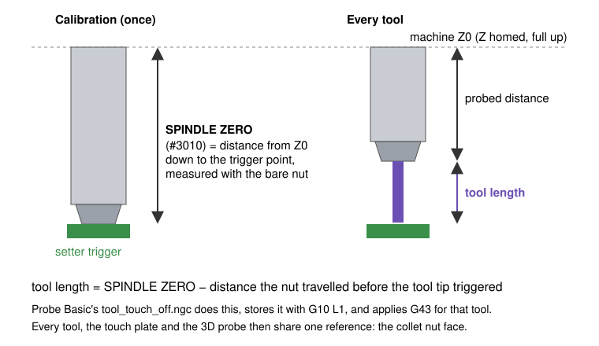

# 6. The tool setter, and measuring every tool automatically

A tool setter is a switch at a fixed spot on the table. Lowering a cutter onto it tells LinuxCNC exactly how far that cutter's tip sits below the spindle reference, which is its tool length. With one, tool changes stop being a source of depth errors.



## One-time setup (PROBING → TOOL SETTER)

<!-- shot: tool-setter-tab -->

### 1. Wire it to the probe input

LinuxCNC has one probe input (`motion.probe-input`). If you have a 3D probe, a touch plate and a setter, OR them together in HAL so any of them triggers probing. On the reference machine the setter is normally-closed, so its input is inverted (`input-06-not`) before the OR. See `config/6040_7i96s/hallib/6040_7i96s.hal`.

### 2. Set the touch-off position (G30)

1. Jog the spindle so its centerline is over the middle of the setter's button.
2. Raise Z to the top (machine Z0).
3. Press **SET TOOL TOUCH OFF POS**.

This stores the position as G30 (parameters #5181–#5183). **GO TO G30** returns there.

### 3. Set SPINDLE ZERO (#3010)

SPINDLE ZERO is the distance from machine Z0 down to the setter's trigger point, measured with the reference surface: the bare collet nut, or whatever you call "length zero". Probe Basic's own help text says it must be entered as a positive number.

- **The direct way**: with no tool in the spindle (nut only), jog down slowly until the setter triggers, and enter the distance travelled.
- **PROBE SPINDLE NOSE ZERO** automates this if your spindle nose can safely press the setter.

> **On the 6040.** SPINDLE ZERO was first worked out from a caliper measurement of a tool's stick-out. That turned out to be 0.565 mm off, because measuring stick-out by caliper is harder than it looks. Measuring with the bare nut (49.1901 mm) fixed it, and every stored tool length and the G54 Z were shifted together by the same amount. Lesson: calibrate the reference directly. Don't derive it from a measured tool.

### 4. Feeds and distances

| Setting | # | Meaning |
|---|---|---|
| Fast probe FR | 3004 | First touch. Slow enough that the overshoot after triggering doesn't hurt the setter. |
| Slow probe FR | 3005 | Measuring touch. 0 skips it. |
| Traverse FR | 3006 | Moves to and from the setter. |
| Z max travel | 3007 | How far down it searches before failing. Must reach your shortest tool. |
| XY max travel | 3008 | For diameter probing. |
| Retract dist | 3009 | Back-off between the two touches. |
| TOOL DIAM OFFSET + direction | 3012/3013 | Offsets large tools (face mills) by their radius so the edge, not the empty center, lands on the button. |

## Measuring a tool by hand

Load the tool (T box + **M6 G43**, or `T5 M6` in MDI), then press **TOUCH OFF CURRENT TOOL** on the TOOL tab. The machine:

1. lifts to machine Z0 and moves to the G30 position,
2. probes down fast, retracts, probes slowly,
3. lifts back to Z0,
4. stores the length in the tool table, and applies **G43** for that tool.

Repeatability on the reference machine: about 0.007 mm.

## Measuring at every tool change (M6 remap)

By default, `M6` in LinuxCNC only asks you to change the tool; it doesn't measure it. Unless you measured each tool beforehand, a program would then run with whatever length is in the table. Changing what M6 does is called a **remap**. This one makes every tool change, from a program, MDI or the M6 G43 button, measure the new tool.

The subroutine, `subroutines/pb_m6_touchoff.ngc`:

```
o<pb_m6_touchoff> sub
M5                          (spindle off before anything moves to the setter)
M6                          (built-in manual change: Z up, insert-tool prompt)
M66 E0 L0                   (stop read-ahead so the new tool is current)
o100 if [#<_task> EQ 1]
  o110 if [[#<selected_tool> GT 0] AND [#<selected_tool> NE #3014]]
    o<tool_touch_off> call
  o110 endif
o100 endif
o<pb_m6_touchoff> endsub [1]
M2
```

And in the INI:

```
[RS274NGC]
REMAP = M6 modalgroup=6 prolog=change_prolog ngc=pb_m6_touchoff epilog=change_epilog

[PYTHON]
PATH_PREPEND = python
TOPLEVEL = python/toplevel.py
```

The `python/` folder holds LinuxCNC's standard remap glue (`toplevel.py` → `remap.py` → `stdglue.py`). Probe Basic's sample configs already include it.

Details that matter:

- **Inside a remap subroutine, `M6` means the built-in tool change.** It doesn't call itself.
- **`#<_task> EQ 1`** is true only when the program really runs. The preview interpreter has `_task = 0`. Without this guard, the preview tries to "probe", the probe never triggers, and the preview stops after a few lines.
- **The probe tool is skipped**, so the setter never presses the probe's stylus. T0 (empty spindle) is skipped too.
- **`endsub [1]`**: the standard epilog requires the remap to return a value.
- **Comments can't contain parentheses.** `(T99 (probe))` is an error in G-code. The interpreter stops with "nested comment".

After enabling it, a Fusion 360 program with plain `T5 M6` lines measures every tool with no edits. See chapter 10.
